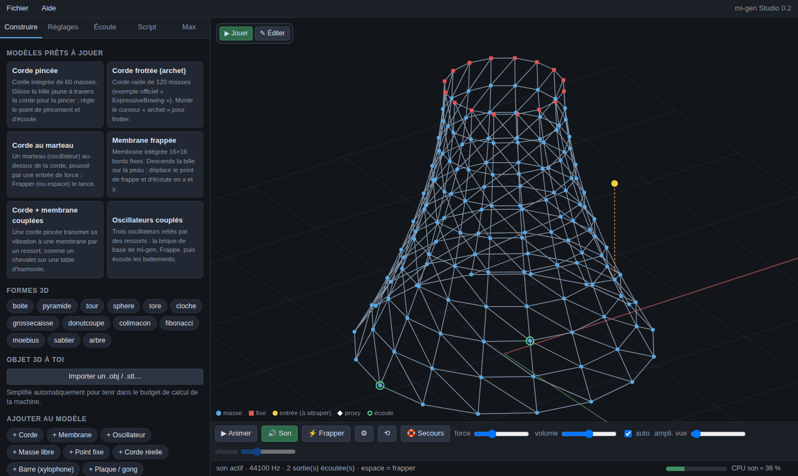
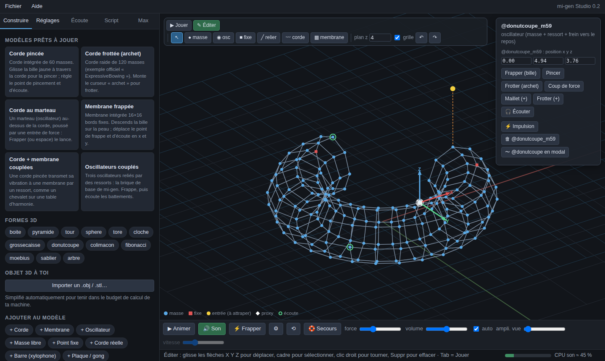
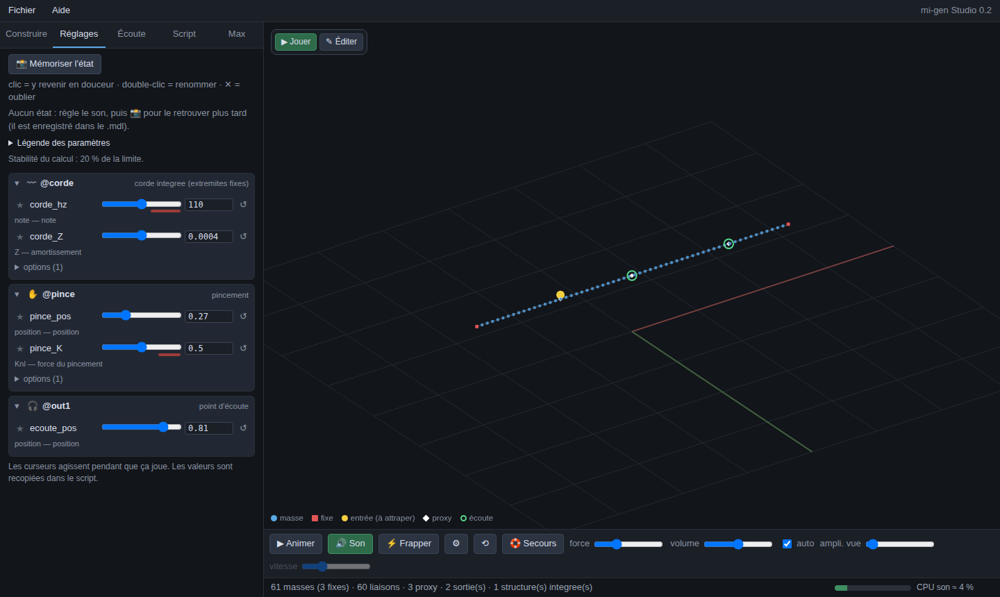
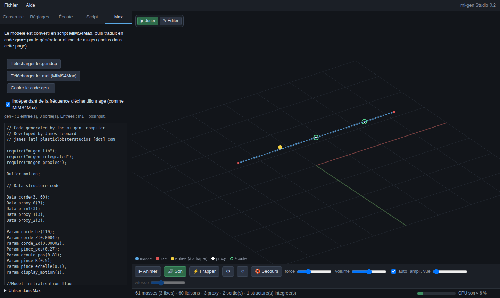

<div align="center">

# mi-gen Studio

**Construire, jouer et entendre des modèles physiques masses-interactions dans le navigateur, puis les exporter vers Max/MSP `gen~`.**

[](https://github.com/Dremor412/dataset412/actions/workflows/tests.yml)
[](LICENSE)


[**▶ Essayer en ligne**](https://dremor412.github.io/dataset412/) ·
[Télécharger le studio](mims-studio/MIMS_Studio.html) ·
[Librairie migen-plus](mi-gen-lib/MIGEN-PLUS.md) ·
[Documentation complète](mims-studio/README.md)



</div>

Un environnement de création pour [**mi-gen**](https://github.com/mi-creative/mi-gen)
(James Leonard, GIPSA-Lab), la boîte à outils de synthèse sonore par
masses-interactions pour Max/MSP. Le studio calcule le son **exactement comme
`gen~`** : un pas par échantillon, mêmes équations, même format de fichier
(MIMS4Max). Ce que tu entends dans la page est ce que tu entendras dans Max.

## Démarrer en 30 secondes

1. Ouvre [`mims-studio/MIMS_Studio.html`](mims-studio/MIMS_Studio.html) dans
   Chrome, Edge, Firefox ou Safari (ou la [version en ligne](https://dremor412.github.io/dataset412/)).
   Un seul fichier, rien à installer, tout tourne en local.
2. Choisis un modèle prêt à jouer (« Corde pincée »), clique **🔊 Son**, puis
   frappe avec la **barre espace**.
3. Onglet **Max** → **Télécharger le .gendsp**, et glisse-le dans un `[gen~]`.

Le menu **Aide → Tutoriel pas à pas** guide la suite, avec « Le faire pour
moi » à chaque étape.

## Ce que ça fait

| | |
|---|---|
| **Construire** | Modèles prêts à jouer, 13 formes 3D paramétriques, briques mi-gen (corde, membrane, oscillateur…) et structures intégrées. Les formes sont accrochées par leurs extrémités et posées sur un sol : elles ne passent jamais sous le plan. |
| **Importer** | Objets `.obj` / `.stl`, simplifiés automatiquement pour **tenir dans le budget CPU de ta machine** (mesuré au démarrage). |
| **Éditer en 3D** | Touche Tab : poignées X/Y/Z, sélection au cadre, poser masses et points fixes, tracer cordes et membranes, relier, annuler / refaire. |
| **Jouer** | Son temps réel (AudioWorklet), bille à attraper, archet, maillet, frappe à force aléatoire, répétition en BPM. |
| **Écouter** | Plusieurs points d'écoute, en stéréo (panoramique, gain) ou un canal par sortie. |
| **Régler** | Un calque par objet, favoris ⭐, légende de chaque paramètre, zone rouge = limite de stabilité. Les changements glissent sans clic. 📸 mémorise un état dans le `.mdl`. |
| **Sécurité** | Marge de stabilité affichée, bouton **Secours** qui revient aux derniers réglages stables, anti-craquements. |
| **Exporter** | `.gendsp` produit par le **générateur officiel MIMS4Max** (inclus), `.mdl` compatible MIMS4Max. Les `.mdl` de mi-gen s'ouvrent tels quels. |

<table>
<tr>
<td width="33%"><br><sub><b>Éditer</b> : poignées 3D, inspecteur, actions sur un point</sub></td>
<td width="33%"><br><sub><b>Régler</b> : calques par objet, légende, limites de stabilité</sub></td>
<td width="33%"><br><sub><b>Exporter</b> : code gen~ et .gendsp prêts pour Max</sub></td>
</tr>
</table>

## migen-plus : plus de physique, moins de calcul

[`mi-gen-lib/migen-plus.genexpr`](mi-gen-lib/migen-plus.genexpr) est une
librairie `gen~` qui **s'ajoute** à mi-gen (même format de données, les
fonctions se mélangent librement) :

- **Flexion** des cordes et des barres : partiels inharmoniques du piano, du
  xylophone, de la cloche. **Modulation de tension** : la note qui monte quand
  on frappe fort.
- **Plaque** avec épaisseur : gong, tôle.
- **Objets modaux** : un objet 3D de centaines de masses devient quelques
  dizaines de modes. La cloche : 40 modes, **~6× moins de calcul**, code gen~
  **5× plus court**, spectre fidèle à 98,5 % ; stable même très raide.
- **Choc de Hunt-Crossley** (sans clic, dureté réaliste) et **frottement de
  Stribeck** (archet, verre chantant).
- **Paramètres physiques** : matériau, longueur, diamètre, tension → `K`,
  `Kb` et l'amortissement en découlent, toujours réglables en direct dans Max.

Détails, formules et choix écartés : [`MIGEN-PLUS.md`](mi-gen-lib/MIGEN-PLUS.md).

## Utiliser dans Max

1. Installe le package [mi-gen](https://github.com/mi-creative/mi-gen) dans
   Max.
2. Si ton modèle utilise migen-plus, copie
   [`migen-plus.genexpr`](mi-gen-lib/migen-plus.genexpr) dans le dossier
   `code` du package, à côté de `migen-lib.genexpr`.
3. Exporte depuis le studio (onglet **Max**) et ouvre le `.gendsp` dans un
   `[gen~]`. Les entrées et sorties sont listées dans l'onglet.

## Fiabilité

Chaque modification est vérifiée automatiquement ([workflow tests](.github/workflows/tests.yml)) :

- les **55 exemples officiels** de mi-gen donnent un code `gen~` identique,
  caractère pour caractère, à celui de MIMS4Max ;
- le code `gen~` exporté, exécuté avec les vraies librairies `.genexpr`,
  calcule **exactement** comme le studio (écart ≤ 1e-12 sur 11 modèles, dont
  4 modaux) ;
- toute l'interface est pilotée dans Chromium (construire, éditer, jouer,
  régler, exporter).

## Organisation du dépôt

```
mims-studio/
  MIMS_Studio.html    le studio, prêt à l'emploi (généré depuis src/)
  src/                sources : moteur physique, son, vue 3D, interface
  tests/              tests Playwright et vérification du code gen~
  README.md           documentation complète, format des fichiers
mi-gen-lib/
  migen-lib / migen-integrated / migen-proxies.genexpr   librairies mi-gen d'origine
  migen-plus.genexpr  la nouvelle librairie
  MIGEN-PLUS.md       sa documentation
docs/images/          captures de cette page
```

## Développer

```sh
cd mims-studio
npm install && npx playwright install chromium
npm run build        # src/ -> MIMS_Studio.html
npm test             # tests de l'interface et du code gen~
npm run captures     # régénère les images de cette page
```

On modifie `src/`, jamais `MIMS_Studio.html` directement. La structure des
sources est décrite dans [`mims-studio/README.md`](mims-studio/README.md#organisation).

## Crédits et licence

- [mi-gen](https://github.com/mi-creative/mi-gen) et MIMS4Max : James Leonard
  et l'équipe mi-creative (GIPSA-Lab, Grenoble), sous GPL v3. Les librairies
  d'origine et le générateur officiel sont inclus sans modification.
- Le studio et migen-plus sont distribués sous la même licence,
  [GNU GPL v3](LICENSE).

---

<details>
<summary><b>English summary</b></summary>

**mi-gen Studio** is a browser-based workbench for
[mi-gen](https://github.com/mi-creative/mi-gen), the mass-interaction physical
modelling toolkit for Max/MSP `gen~`. Build models (ready-made instruments,
parametric 3D shapes, imported `.obj`/`.stl` meshes sized to your CPU), edit
them in 3D, play them with real-time sound computed sample by sample exactly
like `gen~`, then export a `.gendsp` produced by the official MIMS4Max code
generator. Single HTML file, nothing to install:
[try it online](https://dremor412.github.io/dataset412/).

**migen-plus** is an add-on `gen~` library: bending stiffness and tension
modulation for strings and bars, plates, **modal objects** (a 144-mass bell
becomes 40 modes: ~6× cheaper, 98.5 % spectral match), Hunt-Crossley impacts
and Stribeck friction, with physical parameters (material, length, diameter,
tension). The UI and docs are in French.

</details>
